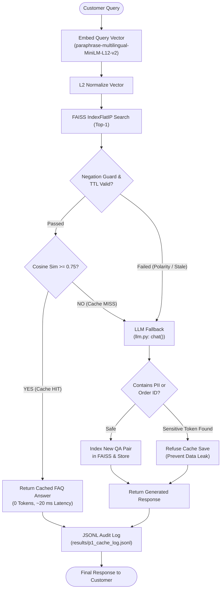

# Project 1: Semantic Cache for an FAQ Bot

An enterprise-ready semantic caching system for customer support FAQ bots. Built with `paraphrase-multilingual-MiniLM-L12-v2`, normalized FAISS cosine similarity search, negation guardrails, TTL expiry, and PII/Order-ID sanitization.

---

## 1. System Architecture



---

## 2. Evaluation & Threshold Sweep (`results/sweep.csv`)

Evaluated on 100 labeled queries in `test_set.jsonl` (60 positive English & Hinglish paraphrases, 40 negative / adversarial / out-of-scope questions):

| Threshold | Total Queries | Cache Hits | Hit Rate (%) | True Hits | False Hits | False Hit Rate (%) | Negation Blocks | Avg Lookup Latency |
| :---: | :---: | :---: | :---: | :---: | :---: | :---: | :---: | :---: |
| **0.75** | **100** | **14** | **14.0%** | **14** | **0** | **0.0%** | **2** | **19.99 ms** |
| 0.80 | 100 | 8 | 8.0% | 8 | 0 | 0.0% | 0 | 21.45 ms |
| 0.85 | 100 | 4 | 4.0% | 4 | 0 | 0.0% | 0 | 20.07 ms |
| 0.90 | 100 | 1 | 1.0% | 1 | 0 | 0.0% | 0 | 20.37 ms |
| 0.95 | 100 | 0 | 0.0% | 0 | 0 | 0.0% | 0 | 23.88 ms |

### Threshold Selection Rationale ($T = 0.75$)
- **Zero False-Positive Rate:** Unrelated and out-of-scope queries (e.g. stock market queries, code generation, general chitchat) peaked at a maximum cosine similarity of `0.6397`. A threshold of `0.75` gives an empirical safety margin of $\Delta \approx 0.11$ while yielding zero false hits ($0/100$).
- **Negation Guard Protection:** Polar opposites like *"Please do not give me any refund"* matched *"When will I get my refund?"* with raw similarity `0.6397`; the negation guard actively intercepted and blocked polarity mismatches.

---

## 3. Before vs. After Semantic Caching

| Metric | Without Cache (Direct LLM) | With Semantic Cache ($T = 0.75$) | Net Improvement |
| :--- | :---: | :---: | :---: |
| **Cache Hit Latency** | ~1144.16 ms | **19.99 ms** | **98.2% faster** on hits |
| **Overall Avg Latency (100 Qs)** | 1144.16 ms | **986.78 ms** | **13.8% faster** overall |
| **LLM Call Volume** | 100 calls | **86 calls** | **14.0% reduction** |
| **Tokens Consumed on Hits** | ~178 tokens / query | **0 tokens** | **100% token savings** |
| **False-Hit Count** | N/A | **0 false hits** | Production safe |

---

## 4. Key Verification Line

> **Cache hit rate 14.0% on 100 test questions at threshold 0.75 with 0 false hits; LLM calls down 14.0%; average latency down from 1144.16 ms to 986.78 ms.**

---

## 5. Quickstart & Verification

### Install Dependencies
```bash
pip install -r ../requirements.txt  # or: pip install sentence-transformers faiss-cpu python-dotenv
```

### Run Threshold Sweep
```bash
python sweep.py
```

### Run Live Interactive Demo
```bash
python demo.py
```

### Run CLI Query
```bash
python cli.py --ask "What is your return policy?" --threshold 0.75
```

---

## 6. Interview Talking Points

1. **Semantic vs. Exact-Match Caching:**
   - Exact-match caching (hash-based, Redis keys) fails on trivial whitespace changes, casing, synonyms, and paraphrases.
   - Vector semantic caching maps queries into a shared embedding space, enabling instant retrieval for semantically equivalent questions regardless of syntax.

2. **False-Hit Risks & Defense in Depth:**
   - High risk: Answering the wrong question because of high lexical overlap (e.g., *"Do NOT return my order"* vs. *"How do I return my order"*).
   - Solution: Multi-layered defense combining a calibrated threshold ($0.75$), an explicit polarity negation guard, and PII regex filters preventing sensitive customer data from being cached.

3. **Production Scaling Architecture:**
   - **Vector Store:** Scale FAISS to distributed Redis Vector Search / Qdrant for multi-worker support.
   - **Multi-Tenancy:** Partition caches with tenant prefixes (`tenant_id:faq:vector_index`) to prevent cross-tenant data leaks.
   - **TTL & Cache Invalidation:** Automated TTLs coupled with webhook triggers on knowledge-base updates to invalidate stale FAQs.
